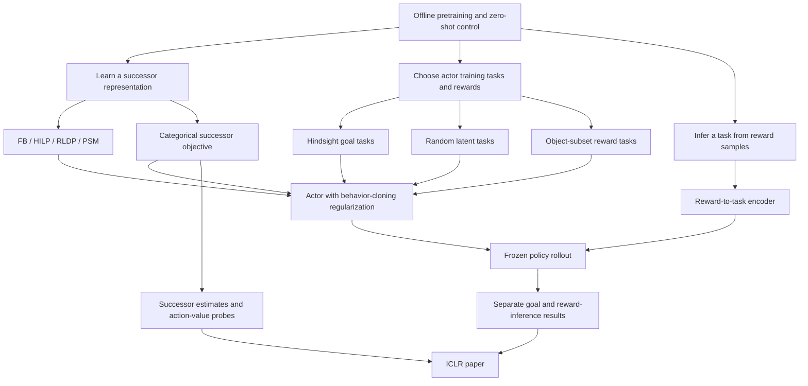

# Factored-FB project map

Orientation snapshot: 2026-09-10, branch `density-fb`, commit `b8b3017`.
Prepared from local source, the current paper, research notes, and shared Claude
memory. This is a navigation aid, not a fresh experiment audit. No training,
evaluation, remote status checks, or test suite was run to produce it.

## Scientific aim

Learn reusable control from offline data. At deployment, specify a task with reward
samples, infer a task vector, and execute a frozen policy without fine-tuning.
Manipulation is the central test: a representation can predict much of the data
while failing to distinguish actions needed to move and retain control of objects.

The proposed contribution is the **normalized, categorical successor objective**,
applied to FB, HILP, and RLDP. Density-FB is its principal implementation, not the
entire scientific claim. PSM and its density variant are also implemented.
A general reward interface is an explicit user requirement; success with a policy
given the goal directly is insufficient by itself.

Keep four questions separate:

1. Does the critic's successor estimate preserve useful differences between actions?
2. What reward does the actor maximize under that estimate?
3. Do the actor's training tasks cover tasks inferred from deployment rewards?
4. Are comparisons matched for representation input, configuration, and evaluation?

The working explanation is that squared regression can under-resolve short-lived,
task-relevant outcomes when persistent outcomes have large successor targets.
The categorical objective learns a distribution over future-state candidates.
The toy experiments support aspects of this explanation; they do not prove a
universal causal explanation for every manipulation failure.

Sources: [abstract](../PAPER/ICLR/content/abstract.tex),
[method](../PAPER/ICLR/content/method.tex),
[September 4 mechanism synthesis](notes/2026-09-04-density-fb-central-perspective.md),
and shared memory `method-is-the-density-objective.md`.

## Mind map

## Runtime architecture

The primary stack is Python/JAX/Flax/Optax, with vendored OGBench environments.
The package is named `factored-fb`; the README calls the project Density-FB.

| Responsibility | Source and connection |
|---|---|
| Training entry | [impls/main.py](../impls/main.py): resolve config, load data, create agent, update, evaluate, log, checkpoint. |
| Actual config entry | [env/config.py](../env/config.py): merge domain, then critic, then actor, then overrides. Domain lookup starts in `env/domains/`, falling back to `impls/configs/domain/`. |
| Config helpers | [config_utils.py](../impls/utils/config_utils.py): loaders and validation; also has the older all-`impls/configs` composer. |
| Agent composition | [impls/agents/__init__.py](../impls/agents/__init__.py): authoritative critic registry, config aliases, actor registry, optimizer groups, generic staged update. |
| Critic contract | [critics/base.py](../impls/critics/base.py): parameter groups, update stages, target networks, actor conditioning, Q readout, reward inference, bootstrap-task declaration. |
| Actor contract | [actors/base.py](../impls/actors/base.py): bootstrap draws, actor loss, action sampling. |
| Dataset transforms | [datasets.py](../impls/utils/datasets.py): basic transitions, goal sampling, hierarchical goals, temporal windows, HILP future sampling. `make_dataset` chooses the wrapper. |
| Environment boundary | [env/base.py](../env/base.py): adapter owns data loading, task enumeration and evaluation; `needs_goal_frame` controls whether a goal is supplied. |
| OGBench path | [env/ogbench.py](../env/ogbench.py): datasets, task evaluation, reward relabeling from simulator state. |
| Other environments | [env/unified.py](../env/unified.py), [registry](../env/registry.py), family-specific loaders. |
| Optional online training | [env/online.py](../env/online.py): whole-episode replay and collection through the same dataset interface. |
| Checkpoints | [flax_utils.py](../impls/utils/flax_utils.py), [resume documentation](resuming_runs.md). |
| Reward-inference rollout wrapper | [eval_cond.py](../impls/utils/eval_cond.py): prevents environment goals from overwriting the inferred task. |

An update samples task conditioning and bootstrap randomness, updates each critic
stage, updates the actor, updates target networks, then updates optional critic
statistics. Some reference-replication configs require all stages to read the same
pre-update parameters. Density-FB's task encoder maintains a slow backward network,
running feature mean/covariance, and a frozen evaluation sample pool.

Registered critic classes: FB, GCIQL, GCIVL, HIQL, bilinear IQL, CRL, QRL,
Density-FB, PSM, RLDP, Density-PSM, Density-RLDP, HILP, Density-HILP.
Many experiment names are YAML aliases of these classes, not separate algorithms.
Registered actors: FlowBC, DDPG+BC, AWR, FQL, two density-specific DDPG+BC
variants, and a pure flow behavior-cloning control.

FlowBC learns an observation-conditioned flow from data actions and distills it
into a task-conditioned one-step actor. The one-step actor also maximizes the
critic's value. The flow itself does not receive the task. Source:
[flowbc.py](../impls/actors/flowbc.py).

There is also a specialized PyTorch FB-CPR density implementation for HumEnv:
[fbcpr_density.py](../impls/torch_density/fbcpr_density.py) and
[training script](../scripts/fbcpr_density_train_humenv.py). Historical statements
that the project contains no PyTorch density implementation are no longer current.

## What Density-FB actually computes

Read [density_fb.py](../impls/critics/density_fb.py) for current behavior; several
older summaries describe different versions.

- The forward network consumes observation, action, and either goal or task vector.
  Its dot product with backward features supplies **logits**, not the actor's Q.
- Softmax over minibatch next-state candidates produces a distribution for each
  forward head. The hard-target implementation fits cross-entropy to
  `(1 - gamma) * one_hot(own_next_state) + gamma * target_distribution`.
  The bootstrap action must use the same task as the critic's forward prediction.
- The actor value is a weighted sum of candidate rewards under each predicted
  distribution; the code takes the minimum of the two resulting values. Critic
  parameters and rewards are frozen for this update, but gradients pass through
  the actor's action. It is not the usual FB value `F(s,a,z) dot z`.
- Goal-conditioned training uses a Gaussian-shaped goal reward over selected task
  coordinates. **The implemented reward is normalized across the candidate set**
  by `_delta_phi`; it is not simply an unnormalized Gaussian or a binary success
  indicator. This scaling matters when comparing actor task families.
- Reward-index training encodes rewards through centered backward features and a
  regularized covariance solve, then normalizes the coefficient vector. Centering
  addresses the invariance of softmax to a common feature translation.
- The default reward-index YAML still uses centered latent rewards and 50% random
  task vectors. Exact goal-reward readout and object-subset tasks are implemented
  options; their presence in code does not make them the default campaign method.
- In exact-reward mode, hindsight rows use the candidate-normalized goal reward;
  random-vector rows retain the centered latent reward. Object-subset rows use
  the exact corresponding masked reward. This mixture is scientifically relevant.
- Backward-network input can be selected task coordinates or full state. That
  choice is distinct from which coordinates define the training reward.
- The pixel variant uses image encoders and a separate privileged simulator-state
  channel for rewards. Reward-index conditioning on pixels explicitly raises
  `NotImplementedError` in the current build path.

Relevant sources: `stage_loss`, `q_fn`, `z_actor_reward_rows`, `_delta_phi`,
`sample_cond`, `infer_cond`, and `map_eval_cond` in the critic;
[reward-index config](../impls/configs/critic/density_fb_z.yaml).

Paper/code distinction to inspect before mathematical claims: the paper presents
a terminal-dependent discount and a raw Gaussian reward. The current Density-FB
loss uses its scalar discount directly, and its goal-reward helper normalizes over
candidates. This orientation pass identified the difference, but did not audit
its consequences or change either source.

## Evaluation distinctions that must survive every summary

**Goal-conditioned evaluation (called Route A in existing notes):** the rollout
gets the environment goal. Some critics use it directly; others encode it into
a task vector. It is misleading to say every actor receives raw goal coordinates.

**Reward-inference evaluation (Route B):** relabel sampled dataset states with the
task reward, infer a vector, and roll the actor on that vector. The OGBench table
protocol uses 10,000 samples. `InferredCondAgent` blocks goal forwarding, so a
supplied goal cannot silently replace the inferred task.

Older results contain two separate evaluation defects:

- The goal-only density model has no native reward-inference implementation.
  Historical zero-goal rollouts are invalid reward-inference results. The current
  guard writes invalid results rather than scoring those rollouts.
- Some HILP-family goal evaluations used a zero task vector because goal mapping
  was missing. The mapping repair is committed, but old CSVs are not repaired
  automatically. Those checkpoints require re-evaluation.

These fixes and the task-averaging fix in the results script are present in commit
`305c5d4`; memories calling them uncommitted are stale for this checkout.

The multi-object relabel reward counts satisfied conditions; it is not generally
the conjunction used by goal-reward training. For two cubes, the code returns
the number placed minus two, then the usual evaluation shift adds one.
The two-cube simulator also permutes object/goal assignments at reset while the
reward samples encode a canonical assignment. Existing notes interpret this as
an approximate factor-of-two protocol limitation for fixed-task policies. Preserve
the assumptions: it is not a universal ceiling on the method or the environment.

Source: [relabeling implementation](../env/ogbench.py),
[evaluation control](../impls/main.py),
[results validity rules](notes/2026-09-09-tdjtab-results-aggregate.md).

## Research position in the latest local records

This section summarizes dated records, not independently recomputed scores or live
job status. The shared memory often appends later corrections to earlier verdicts;
read the entire relevant note, especially its final dated additions.

- The September 9 aggregate reports strong reward-inference results for the
  default latent-reward Density-FB on cube-single, cube-double, and scene. It is
  weak on puzzle and loses on antmaze-medium; the latter density result has only
  one seed. Density retrofits alone did not consistently improve HILP/RLDP.
- The [September 11 RLDP/HILP categorical audit](notes/2026-09-11-rldp-hilp-ce-audit.md)
  verifies the current continuing Bellman update and records repaired configuration,
  actor-normalization, object-only HILP goal-label, and latent Density-RLDP
  reward-inference defects. It also identifies the remaining RLDP training-task
  distinction for nonwhite features and an unresolved exact-goal HILP
  training/evaluation index mismatch. Most repaired configuration options were
  inactive in the saved main runs; no new training or checkpoint evaluation was
  performed. The note separates current source findings from historical run
  provenance, which lacks recorded source revisions.
- The September 10 follow-up reports that exact rewards with no random-vector
  tasks improve cube-single across three seeds, but hurt scene reward inference.
  Thus the all-goal training distribution is not an established general replacement.
- Mixing candidate-normalized exact rewards with latent rewards is implicated in
  poor actor training. Reducing the random-vector fraction did not resolve the
  cube-single regression in the reported runs.
- Object-coordinate inputs substantially improve the exact-reward HILP/RLDP
  variants on cube-single in preliminary runs. Earlier full-state comparisons
  cannot isolate the effect of the successor objective. HILP's two evaluation
  routes also move differently; check corrected evaluations before broad claims.
- Training rewards over random object subsets are implemented in `b8b3017`.
  Reported early results improve two-cube goal evaluation, while scene reward
  inference remains an open question. Intermediate checkpoints and single seeds
  must not be presented as final multi-seed results.
- [Task-vector coverage analysis](notes/2026-09-10-z-coverage.md) finds that inferred
  scene/puzzle/multi-object tasks can be far from hindsight-goal training tasks.
  This is useful evidence, not sufficient proof of failure: distance does not
  reliably rank tasks within each environment, and some compared runs differ in
  training duration, seed, and reward.
- [Cube probes](notes/2026-09-04-density-fb-central-perspective.md) do not support
  a simple "FB cannot grasp" explanation: many failures occur after acquiring
  the object, and held starts do not reliably rescue it.
- [FourRooms](notes/2026-09-09-fourrooms-estimator-demo.md) and
  [corridor](notes/2026-09-10-corridor-estimator-demo.md) compare successor fits
  against exact tabular quantities. Distinguish fitting exact successor targets
  from TD training on sampled transitions. The FB fit has a closed-form SVD
  optimum; the density fit is numerically optimized, even when notes loosely
  group both under "closed-form." The corridor TD runs are noisier and the
  density value gap can overshoot the truth.
- **Subsequent k40 audit:** [September 10 audit](notes/2026-09-10-corridor-k40-audit.md)
  reproduces the figures but narrows their interpretation. The weighted SVD
  loses the action-value gap while still selecting the correct action; reference
  weighting strongly affects that result. The separately saved 100k-step TD
  runs retain more of the gap with FB than density. Do not present the k40
  exact-target fit as a demonstrated failure of TD-trained FB.
- **Full-capacity carry/drop diagnostic:** [September 10 results](notes/2026-09-10-carry-drop-results.md)
  crosses transport depth and resting persistence with balanced, full-support
  tabular TD. FB and Density FB both choose every transport action correctly in
  all final expected and sampled runs (54 per method per regime). Expected TD
  has a temporary FB failure at one learning rate; more training, a larger rate,
  or sampling removes the deepest/longest-rest example. Normalized squared TD
  also removes the early expected-update failure. This is not a robust example
  of FB failing at sufficient capacity; retain the recovery controls.
- **Finite-capacity population counterexamples:** the
  [loss-only proof](notes/2026-09-10-loss-only-counterexample.md) compares squared
  loss and cross-entropy within the same stochastic rank-two probability class.
  Its strict control separation requires a chosen uniform reference and backward
  features without spherical normalization. The separate
  [objective counterexample](notes/2026-09-10-objective-counterexample.md) uses the
  natural next-state reference and spherical FB features, but compares linear
  density with log-density classes; squared loss on the softmax class also
  succeeds. Neither is a proof of the mechanism behind trained cube policies.
- **Deterministic finite-capacity counterexample:** the
  [September 11 path proof](notes/2026-09-11-deterministic-path-counterexample.md)
  uses four states, deterministic left/right transitions, uniform continuation,
  and the natural uniform reference. At dimension two, the unique exact-successor
  squared optimum stays beside an interior goal and earns zero from the chosen
  start, while another feasible FB representation predicts this goal's values
  exactly. A categorical KL certificate guarantees optimal return from that
  start; both full-target model classes are misspecified. This is an exact-target
  approximation result with unrestricted backward features and exact reward
  integration, not a loss-only or global TD theorem. The
  [separate TD check](notes/2026-09-11-deterministic-path-td.md) must retain its
  spherical-feature recovery control.
  The [spherical extension](notes/2026-09-11-deterministic-path-spherical-counterexample.md)
  proves global exact-target failure on the same graph with spherical backward
  features and the finite soft orthogonality penalty used by two-head FB at
  coefficient 1000. An exact rational matrix certificate bounds every optimum's
  normalized initial goal gap below -0.02875; a same-capacity spherical witness
  has exact values for this goal. This strengthens the approximation theorem,
  while the separately observed TD recoveries remain relevant.
  The same note also derives the expected FB backward-field potential after
  exactly equilibrating the forward TD factors with instantaneous targets.
  A second exact certificate makes every global minimum of that reduced
  potential fail, without claiming convergence of the full coupled TD updates.
  The [mechanism note](notes/2026-09-11-deterministic-path-mechanism.md) separates
  logit geometry from the loss: the explicit categorical candidate can also
  have spherical, whitened backward features, and squared loss on that same
  softmax family preserves the useful decisions. This example therefore does
  not identify cross-entropy alone as necessary.

Main follow-up memory:
`kernel-actor-negative-500k-20260909.md` (contains updates through September 10).
The paper still describes the default latent-reward deployment plus the
goal-conditioned diagnostic. Do not silently rewrite its claim around an
experimental option when explaining existing tables.

## Environments, experiments, and paper artifacts

Environment families include OGBench manipulation/navigation/puzzles, MetaWorld,
ManiSkill, Box2D, ExoRL/dm_control, and HumEnv. The README's family/domain counts
are dated. Inspect both domain-config directories for supported launch names.
For ExoRL, reconstruct task rewards from physics rather than reusing the reward
column from the task that generated the data. HumEnv data provenance differs
from unsupervised play data; it includes released agent replay.

| Topic | Start here |
|---|---|
| Current paper | [PAPER/ICLR/README.md](../PAPER/ICLR/README.md), [main.tex](../PAPER/ICLR/main.tex), `content/`, `content/appendix/`. This supersedes older paper homes. |
| OGBench comparison campaign | [manifest](../scripts/tdjtab_manifest.sh), [launcher](../scripts/launch_tdjtab.sh), [campaign note](notes/2026-09-07-tdjepa-table-needed-runs.md). |
| Reward-interface campaign | [spec](specs/2026-09-06-partb-reward-inference-campaign.md), [goal versus task-vector matrix](specs/2026-09-06-goal-vs-z-ablation-matrix.md). |
| ExoRL replication | [spec](specs/2026-08-28-exorl-official-parity-validation.md), late-August notes on HILP/RLDP parity and regularization. |
| Mechanism probes | [scripts/probes/cube_bottleneck](../scripts/probes/cube_bottleneck), [eval](../eval), [analysis](../analysis). |
| Toy figures | [analysis/fourrooms_estimator](../analysis/fourrooms_estimator), [analysis/corridor_estimator](../analysis/corridor_estimator). |
| Task coverage | [analysis/z_coverage](../analysis/z_coverage). |
| Per-run artifacts | `exp/`: resolved `config.json`, `train.csv`, `eval.csv`, `eval_relabel.csv`, checkpoints. The resolved config is nested under `config`, not flat. |
| Results generation | [make_results_table.py](../scripts/make_results_table.py): averages tasks per step before taking the last three evaluation steps. |
| Campaign reporting | [campaign](../campaign), [checkpoint uploader](../scripts/hf_upload_checkpoints.py), [mailbox](../scripts/mailbox.py). |

The paper README identifies which table copies are generated elsewhere. Read it
before editing tables. `PAPER/`, `analysis/`, `results/`, `exp/`, `wandb/`, and
the derived graph are ignored local artifacts; a clean Git status does not mean
they are unchanged or shared remotely.

The historical CSV pipeline in shared memory refers to scripts on another
worktree/branch. Its audit found run counts mislabeled as seed counts and some
mixed experimental variants. Verify distinct seed identities, resolved configs,
checkpoint steps, evaluation route, and aggregation before quoting a result.
Never equate best checkpoint, final checkpoint, and mean of the last three.

## Verification and environment notes

The tests focus on reference parity, critic/actor composition, conditioning,
datasets, evaluation correctness, and checkpoint behavior. See
[tests/impls](../tests/impls), [tests/probes](../tests/probes),
[tests/scripts](../tests/scripts), and the [README](../README.md).

Run relevant JAX test files in separate processes; the documented combined suite
can exhaust memory through accumulated XLA compilations. Frozen numerical fixtures
require CPU execution; rendering tests need EGL. Do not regenerate reference
fixtures merely to make changed behavior pass. Test counts in old memories are
historical reports, not verification of the current worktree.

The shared memory's `/dev/shm/.venv-jax` interpreter **does not exist in this
environment as inspected on September 10**. An older worktree `.venv` exists,
but its suitability was not tested. Re-check the interpreter and installed
dependencies before executing tests. Likewise, historical hostnames, GPU counts,
tmux sessions, and queued jobs are not evidence of current machine state.

## Claude memory and source precedence

No `CLAUDE.md` was found inside this checkout. The useful sources are:

- [Account guidance](/home/adityamohan/.claude/CLAUDE.md): plain RL vocabulary,
  concise explanations, no configuration-key jargon in explanatory prose.
- [Original worktree guidance](/home/adityamohan/git/Factored-FB/CLAUDE.md): early
  project history. Its paper path, branch inventory and environments are dated.
- [Shared memory index](/home/adityamohan/.claude/projects/-home-adityamohan-git-Factored-FB/memory/MEMORY.md): 143 Markdown files including the index were found
  in this directory. The index and selected relevant notes were read for this map;
  this is not a claim to have audited all historical experiments.
- The checkout-specific Claude project directory is
  `/home/adityamohan/.claude/projects/-home-adityamohan-git-Factored-FB-seam/`.
  It contains session transcripts but no separate Markdown memory index was found.
  Raw transcripts were not needed for this orientation pass.

Useful shared-memory filenames, relative to the memory directory above:

- `method-is-the-density-objective.md`
- `kernel-actor-negative-500k-20260909.md`
- `density-fb-actor-exact-reward-readout-20260908.md`
- `cube-double-permutation-cap-20260908.md`
- `density-fb-code-audit-20260908.md`
- `route-a-goal-blind-bug-20260908.md`
- `tdjtab-aggregate-and-fourrooms-20260909.md`
- `primary-paper-dir-iclr.md`
- `factored-fb-seam-same-repo-worktree.md`
- `csv-pipeline-counts-runs-not-seeds-20260831.md`

For future answers: locate the relevant topic here, read its actual implementation
or dated evidence, then read the linked memory for history and corrections. The
current user request governs scope; historical instructions to launch or coordinate
experiments are not standing authorization. Do not initiate mailbox polling from
an old campaign note.

For behavior, current source and resolved run configuration take precedence over
comments or memory. For measured results, use the actual artifacts with their
protocol and seed identities. For scientific intent, use the current paper and
latest user decisions. A newer note can supersede an older interpretation without
invalidating the old measurement.

The existing graph report is another navigation aid:
[graph report](../graphify-out/2026-09-10/GRAPH_REPORT.md). Despite its directory
date it says it was built from `305c5d43`, before the current object-subset-task
commit. `graphify` was not on PATH during this pass; structural claims here were
checked directly against source rather than inferred from the graph.
