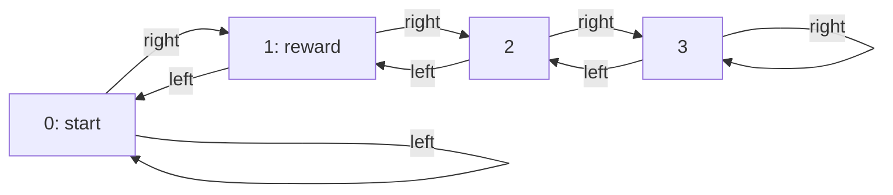

# A deterministic path with control-sufficient capacity and a wrong squared optimum

Date: 2026-09-11. Exact-successor approximation theorem, with an executable
verification and rational interval bounds. No optimization trajectory is needed
for the theorem.

**Spherical extension:** a [separate exact certificate](2026-09-11-deterministic-path-spherical-counterexample.md)
now proves that every global spherical-FB approximation optimum also fails on
this graph with two heads and soft orthogonality coefficient 1000. It uses a
spherical control-sufficient witness and an exact matrix inequality, rather
than identifying the spherical optimum with the SVD below.

On a four-state deterministic path, the unique rank-two squared successor fit
chooses to stay immediately outside a rewarding state. Its policy receives zero
reward from the chosen start. Another rank-two FB representation predicts every
value for this reward exactly. Every global rank-two-logit categorical optimum
achieves the optimal return from that start. Both model classes misspecify the
complete successor target.

The comparison uses unrestricted backward features, a fixed uniform continuation
policy, and exact reward integration. It does not establish a loss-only
separation, cover FB's spherical backward-output constraint, or prove a global
result for bootstrapped TD training or a jointly learned actor and reward encoder.

## Deterministic graph, sampling, and reward

There are four states, indexed 0 through 3, and two actions, left and right:



Each state-action pair has exactly one next state. The environment is
deterministic; only the fixed continuation policy, which selects either action
with probability one half, is stochastic. Both actions are sampled uniformly
at every state. All eight source rows therefore have weight (1/8), and every
state occurs as a next state twice. The natural next-state reference is

\[
\rho=(1/4,1/4,1/4,1/4).
\]

Set (\gamma=4/5). Reward is one on arrival at state 1 and zero otherwise;
there is no termination at the goal. Control is evaluated from state 0. The
continuation transition matrix is symmetric and has uniform stationary measure:

\[
T=\frac12\begin{pmatrix}
1&1&0&0\\1&0&1&0\\0&1&0&1\\0&0&1&1
\end{pmatrix}.
\]

The exact normalized successor distribution conditional on the immediate next
state (i) is row (i) of

\[
N=(1-\gamma)(I-\gamma T)^{-1}
=\frac1{85}\begin{pmatrix}
43&22&12&8\\
22&33&18&12\\
12&18&33&22\\
8&12&22&43
\end{pmatrix}.
\]

Thus the target for source pair ((s,a)) is (N_{f(s,a),:}), where (f) is
the deterministic transition function. Each of the four distinct target rows
occurs twice. The critic's unnormalized action value for reward vector (r)
is (N_{f(s,a),:}r/(1-\gamma)). Multiplication by this positive common scale
does not affect action selection.

## What is being minimized

For the linear FB family, write a normalized prediction as

\[
\widehat N_{s,a,j}=\rho_j F_{s,a}^{\mathsf T}B_j,
\qquad F_{s,a},B_j\in\mathbb R^2.
\]

With exact successor targets, the density-ratio squared objective is

\[
L_{\rm sq}=\mathbb E_{s,a}\sum_j
\frac{(\widehat N_{s,a,j}-N_{f(s,a),j})^2}{\rho_j}.
\]

The unnormalized FB target differs by the common factor (1/(1-\gamma)),
which rescales optimal forward features and the loss without changing the
selected subspace or policy. Uniform source and reference weights reduce the
problem to the ordinary rank-two approximation of (N): its four distinct
rows have weights (1/4), canceled by (\rho_j=1/4). Equivalently, the
weighted eight-row target has exactly the same nonzero singular values as (N).
No equality constraint between duplicate forward rows is needed for this
squared-loss argument.

The categorical family predicts

\[
q_{s,a,j}=\operatorname{softmax}_j(F_{s,a}^{\mathsf T}B_j),
\qquad F_{s,a},B_j\in\mathbb R^2,
\]

and minimizes exact-target cross-entropy. Its excess over target entropy is

\[
L_{\rm KL}=\mathbb E_{s,a}
D_{\rm KL}(N_{f(s,a),:}\Vert q_{s,a,:}).
\]

Both controllers select actions by integrating the specified reward against
their predicted successor distributions. There is no learned actor or
reward-to-task estimation error in the comparison.

## The unique squared optimum chooses the wrong action

The eigenvalues of (T) are (1,1/\sqrt2,0,-1/\sqrt2). Since (T) is
symmetric, (N) is positive definite, and its singular values are

\[
1,\quad\eta=\frac1{5-2\sqrt2},\quad\frac15,
\quad\frac1{5+2\sqrt2}.
\]

The strict gap between the second and third singular values makes the
rank-two squared optimum unique. Let

\[
\psi_i=\frac1{\sqrt2}\cos\!\left(\frac{\pi(i+1/2)}4\right).
\]

The optimum is

\[
\widehat N^{\rm sq}_{ij}=\frac14+\eta\psi_i\psi_j.
\]

It is a valid stochastic matrix, despite the FB class not requiring this:
rows sum to one and its smallest entry is

\[
\frac{20-9\sqrt2}{136}=0.05347116131355>0.
\]

It is therefore also the unique optimum within the smaller class of stochastic
rank-two probability matrices. Its normalized goal predictions are

\[
\widehat N^{\rm sq}_{:,1}
\approx(.33140491,.28371902,.21628098,.16859509),
\]

whereas the true predictions are ((22,33,18,12)/85). At state 0, right
enters the goal and left stays at 0. Their true normalized value difference is

\[
N_{1,1}-N_{0,1}=\frac{11}{85}>0,
\]

but the squared optimum gives

\[
\widehat N^{\rm sq}_{1,1}-\widehat N^{\rm sq}_{0,1}
=\frac{1-3\sqrt2}{68}
=-0.04768589245764<0.
\]

Its greedy policy stays at state 0 forever, for return zero.

The representation retains the broad left-to-right variation of the path.
The retained nonconstant eigenvector decreases from state 0 to state 3, so its
goal prediction is largest at the left endpoint. The true goal value instead
has an interior peak at state 1. The omitted modes create that peak. This
shows how a compact approximation can preserve broad spatial structure while
losing the difference between entering the goal and staying beside it.

## Dimension two is sufficient for this control task

Write (p_i=N_{i,1}) and define

\[
b=(-1,3,-1,-1)/\sqrt3,\qquad B_j=(1,b_j),
\qquad F_i=\left(1,\frac{4p_i-1}{\sqrt3}\right).
\]

For source pair ((s,a)), use forward row (F_{f(s,a)}). The resulting
rank-two prediction is

\[
\widehat N^{\rm ctrl}_{i,j}=
\begin{cases}p_i,&j=1,\\(1-p_i)/3,&j\ne1.\end{cases}
\]

Every entry is positive, every row sums to one, and
\(\mathbb E_\rho[B B^{\mathsf T}]=I\).
This representation predicts the complete action-value function for the chosen
goal exactly, and therefore all of its action differences. Native FB reward
readout agrees: with (z_r=\mathbb E_\rho[B r]),

\[
F_i^{\mathsf T}z_r=\widehat N^{\rm ctrl}_{i,:}r=N_{i,1}.
\]

Both this representation and the squared optimum can attain the minimum of a
backward second-moment orthogonality penalty. Their squared approximation
losses nevertheless satisfy

\[
L_{\rm sq}^{*}=0.05631740052781
<L_{\rm sq}(\widehat N^{\rm ctrl})=0.2250519031142.
\]

Thus the objective selects incorrect control even though the class contains
the exact values for this task. This is not an assertion that two dimensions
can preserve action differences for every reward.

The FB backward features here are not constrained to a sphere. In particular,
the optimum can be written (B_j=(1,2\psi_j)), whose squared row norms are

\[
2+1/\sqrt2,\quad2-1/\sqrt2,\quad2-1/\sqrt2,\quad2+1/\sqrt2.
\]

They are unequal. The theorem does not apply to the production constraint
requiring every backward feature to have the same norm.

## An explicit categorical candidate and a global control certificate

Use these rational, rank-two factors, indexed by immediate successor:

\[
B=\begin{pmatrix}-1&1\\-1/2&-1\\1/2&-1\\1&1\end{pmatrix},
\qquad
F=\begin{pmatrix}
-4/5&1/10\\-2/5&-23/100\\2/5&-23/100\\4/5&1/10
\end{pmatrix}.
\]

The candidate (q=\operatorname{softmax}(FB^{\mathsf T})) has

\[
\frac14\sum_i D_{\rm KL}(N_{i,:}\Vert q_{i,:})
=0.003304199257608<0.003305.
\]

This is a feasible upper bound, not a claimed analytic categorical optimum.
It is also distinct from the separately numerically optimized fit with KL
approximately (0.0032722538). Neither numerical optimization nor the latter
number is used by this proof.

**Existence and duplicate rows.** A global categorical optimum exists. All
target entries are positive. A finite cross-entropy sublevel therefore keeps
each predicted probability bounded away from zero. Its centered logits

\[
C_{s,a,j}=\log q_{s,a,j}-\tfrac14\sum_k\log q_{s,a,k}
\]

are bounded. The feasible set (C\mathbf1=0),
\(\operatorname{rank}(C)\le2\) is closed, so a compact sublevel contains a
minimizer. This argument uses prediction matrices and does not require bounded
factor parameters.

At any global optimum, fix its (B). Each forward row separately minimizes a
convex cross-entropy over its attainable logits. The objective is strictly
convex on centered logits: its Hessian is the covariance of a strictly
positive categorical distribution, with the constant vector as its only null
direction. Consequently identical target rows must have identical predicted
distributions. The two copies of each immediate-successor row therefore have
combined weight (1/4) at every global optimum. This does not presume a
parameter-sharing constraint on the eight forward rows.

**Wrong-order bound.** Suppose two successor rows have true goal probabilities

\[
p>p',\qquad m=(p+p')/2.
\]

Coarsening each row into goal versus non-goal cannot increase KL. If their
predicted goal probabilities are wrongly ordered or tied, (u\le v),
convexity gives

\[
\min_{u\le v}\{\operatorname{kl}(p\Vert u)+
\operatorname{kl}(p'\Vert v)\}
=\operatorname{kl}(p\Vert m)+\operatorname{kl}(p'\Vert m).
\]

The minimizing predictions coincide at (u=v=m). Including the combined
row weights, the lower bound is one quarter of this expression. At state 0,
compare immediate successors 1 and 0; at state 2, compare successors 1 and 3:

| Decision state | Correct/incorrect successor | Wrong-or-tied KL lower bound |
|---|---|---:|
| 0 | 1 / 0 | 0.004806898167084 |
| 2 | 1 / 3 | 0.02019950996663 |

Both exceed the feasible candidate's entire KL objective. Every global
categorical optimum therefore enters the goal from states 0 and 2.

From goal state 1, either action goes to state 0 or state 2; both then return
to the goal. Starting at state 0, such a greedy policy receives reward every
other transition and has return

\[
1+\gamma^2+\gamma^4+\cdots=\frac1{1-\gamma^2}=\frac{25}{9}.
\]

This is optimal: entering the goal requires leaving it before another reward
can occur, so rewards cannot be earned on consecutive transitions. The proof
does not certify the decision at state 3. That state is never visited from the
specified start by these policies. It also does not require the critic to
preserve the fixed-continuation action ordering at the goal itself: either
outgoing action is optimal when followed by the certified greedy policy.

The verifier evaluates all deterministic policies and checks the return of
every policy consistent with the certified decisions. For the KL inequalities,
it additionally computes exact rational intervals for logarithms and
exponentials using convergent series and bounded remainders. These establish
the rounded strict inequalities (L_{\rm KL}<0.003305),
the first wrong-order bound (>0.004806), and the second (>0.020199),
without relying on floating-point rounding of the displayed decimals.

## Both full-target classes are misspecified

All four eigenvalues of (N) are positive, so its probability rank is four.
Its row-centered log-probability matrix has rank three. The latter can also be
seen without a numerical rank threshold. Let (L_{ij}=\log N_{ij}) and
\(C=L(I-\mathbf1\mathbf1^{\mathsf T}/4)\).
On the two-dimensional subspace odd under reversal of the path, its matrix is

\[
\begin{pmatrix}
\log(43/8)&\log(11/6)\\
\log(11/6)&\log(11/6)
\end{pmatrix},
\]

whose determinant is
\(\log(11/6)\log(129/44)>0\).
The even, zero-mean vector ((1,-1,-1,1)/2) has the nonzero even image

\[
\frac12(\log(43/33),\log(4/9),\log(4/9),\log(43/33)).
\]

These are three independent image directions, while (C\mathbf1=0), proving
rank three. Therefore neither rank-two probabilities nor rank-two logits can
represent the exact full target. The categorical candidate has probability
rank four, so the comparison changes model geometry as well as the loss; it
is not the loss-only comparison in the
[separate stochastic construction](2026-09-10-loss-only-counterexample.md).

## Relation to TD training and to the scientific claim

The exact state-action successor obeys the normalized Bellman equation

\[
Y_{s,a,:}=(1-\gamma)e_{f(s,a)}+
\gamma\,\mathbb E_{a'\sim\pi(\cdot\mid f(s,a))}
Y_{f(s,a),a',:}.
\]

The corresponding categorical TD target replaces the final (Y) with a
target-network prediction; FB uses the unnormalized density-ratio form.
Those targets change during learning. The theorem above instead minimizes
approximation error against the exact fixed point (Y), and its categorical
KL certificate is a certificate for that exact-target objective.

Reversibility helps relate the FB subspaces: with this deterministic transition
map and the natural uniform weights, eliminating an exactly equilibrated
forward factor from an idealized whitened FB semi-gradient field leaves the
backward operator proportional to ((I-\gamma T)^{-1}). Its eigenvectors and
ordering agree with those of the exact-successor squared problem. This
observation does not prove convergence of simultaneous factor updates with
target networks, or define a global TD objective to which the SVD theorem can
be applied.

The [separate TD check](2026-09-11-deterministic-path-td.md) reports expected
bootstrapped training on this same graph. With unrestricted FB backward
features, all six runs choose the wrong initial action at 100,000 updates;
all six categorical runs choose correctly. The spherical FB control has both
correct and incorrect runs, so it does not extend this theorem to production
spherical features. Those are training observations with their own protocol,
separate from the global exact-target certificate.

The graph isolates an interior-goal control bottleneck with balanced,
full-support data. It does not model carrying, dropping, or resting-state
persistence. The result shows a possible failure of capacity allocation by a
successor approximation objective; it does not establish the cause of learned
manipulation failures. The policy used to define the successor target is fixed
and uniform, and the reward readout is exact. There is no theorem here about
jointly learned task-conditioned policies, a learned reward encoder,
reward-inference evaluation, or control for every reward.

## Reproduction

From the repository root, run with Python and NumPy:

```bash
python scripts/didactic/verify_deterministic_path.py
```

The interpreter used for the saved verification in this checkout was:

```bash
../Factored-FB/.venv/bin/python scripts/didactic/verify_deterministic_path.py
```

The [verifier](../../scripts/didactic/verify_deterministic_path.py) prints the
target, factors, squared optimum, action gaps, rank checks, policy returns, and
rational KL intervals as JSON, ending with `"all_assertions_passed": true`.
It performs no training or parameter search.
