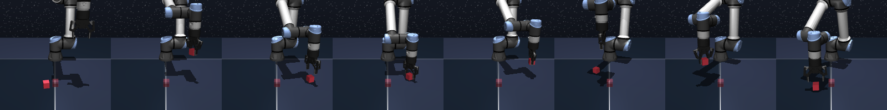
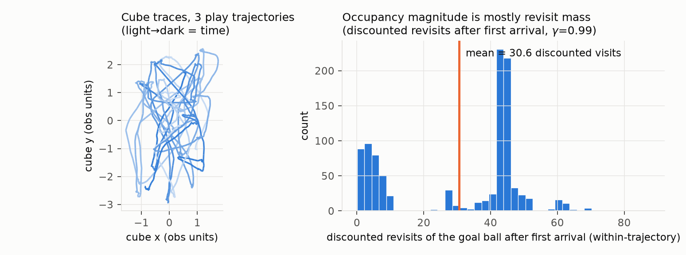
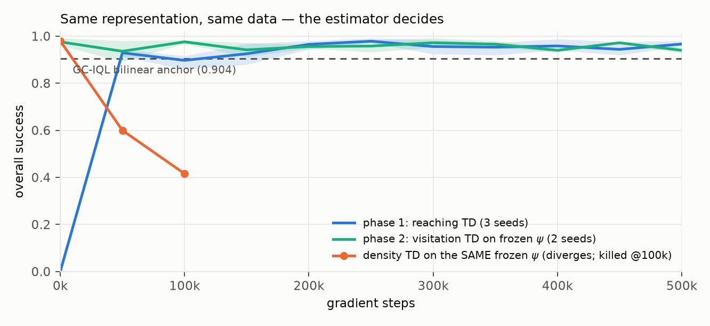
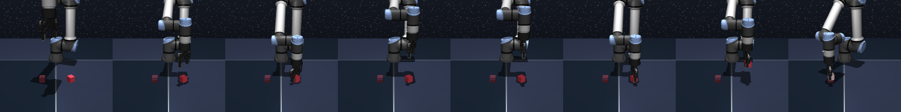
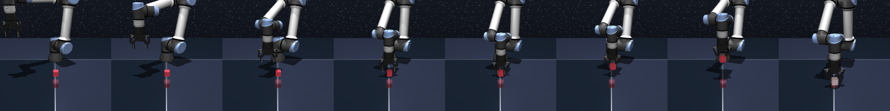
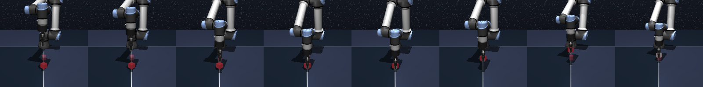
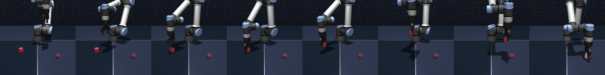
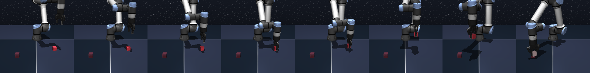
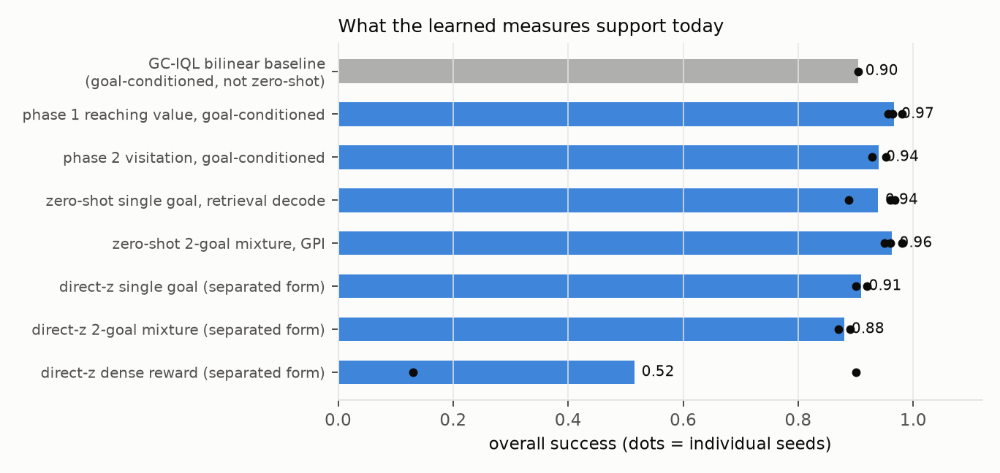

# Successor measures for manipulation — the intuition, the algorithm, the numbers

**Status report, 2026-07-23.** One environment throughout: OGBench `cube-single`
(state observations, five tasks, 50 episodes/task, 500k gradient steps, 2–3 seeds per
cell). Figures regenerate with `figures/make_report_figures.py`; rollout strips with
`scripts/rescuing_fb/render_rollout_strips.py`; the external writeup is
`PAPER/rescuing-fb/two-phase-successor-measure-note.tex`; the per-decision campaign log
is `PAPER/rescuing-fb/DECISIONS.md`.

## The problem and the pitch

Zero-shot RL from unlabeled play data: train once without rewards; at test time, given a
reward, produce a policy with no further training. The canonical object is the successor
measure (discounted occupancy of future states); the canonical method (FB) learns it as
a bilinear factorization `F(s,a,z)·B(x)`. On cube manipulation this loses badly to a
plain goal-conditioned value baseline on the same data with the same actor class:
**FB ≈ 0.42 vs. goal-conditioned IQL with a bilinear critic 0.904**.

**Central result:** measure-style training now works here — reaching value **0.967**
(independently re-verified 0.972/0.988/0.984), a genuine visitation measure at
**0.95** through a full run, the task-conditioned (z,x)-separated critic at
**0.90–0.96**, and first direct-z zero-shot extraction at **0.87–0.92** with no goal
decoding. **Central pitch:** the failure was never representation capacity — it was the
training signal, and the story starts with what play data actually looks like.

---

## 1 — What play data looks like


*A real trajectory from our training dataset (`cube-single-play-v0`), rendered by
replaying the dataset's stored simulator states — video at
`figures/cube-single-play-data.mp4`. The scripted collector moves the cube, pauses,
re-grasps, and returns to the same configurations over and over.*



Two properties matter. **The cube dwells**: between manipulations it sits still, so
trajectories spend most of their time *at* configurations, not between them. **The data
revisits**: the same regions are entered again and again within a trajectory. Quantified
at our goal definition (a 4 cm ball around a cube position, γ=0.99): after first
arrival, a trajectory accumulates on average **≈ 25–30 further discounted visits** of
the same ball (right panel; the bimodality is "passed through" vs. "settled there").
Meanwhile a goal-only regressor of this revisit mass explains Monte-Carlo occupancy at
rank correlation ≈ 0.6 uniformly across horizons, while the reaching term alone explains
≈ 0.06.

**The consequence:** the successor measure's *magnitude* on this data is almost entirely
revisit mass — and revisit mass is nearly action-independent (the cube sits still no
matter which action reached it). A learner trained to match occupancy spends its
capacity on the part that carries no control signal.

## 2 — Why "reach first" is the right objective here

Occupancy of a small goal ball factors at the first arrival:

```
M(s,a,ball(g))  ≈  E[γ^T]  ×  R(g)
                   reaching     revisit mass
                   (control)    (≈ action-independent)
```

Everything control needs is in the first factor; almost all the magnitude is in the
second. So the natural curriculum is: **learn the reaching factor first, as its own
objective** — and it happens to be the one object in the family with a representable,
bounded reward. Arrival at the ball is a 0/1 event a network can regress; the Dirac
density that the standard measure TD needs is not, which is why FB's estimator handles
its "observed successor" term *linearly* (a term that always pays for making the measure
larger) and then leans on an orthonormality regularizer to keep scales sane.

Both crutches measurably fail on this data:

| Canonical ingredient | Measured effect |
|---|---|
| Orthonormality regularizer on ψ | 0.967 → 0.225 on the working cell |
| Density TD, from scratch (all variants, deconfounded) | ≤ 0.10, occupancy dial 0.00 flat |
| Density TD **on a frozen, known-good ψ** | diverges: critic scale 154 → 5×10⁴, success 0.98 → 0.42 @100k (3 seeds; faster with ψ trainable) |
| Conservatism (min-aggregation) | 0.240 — hurts |
| One-step FB | 0.067 ≈ BC floor |

The frozen-ψ row is the mechanism result: divergence with a *perfect* representation
means the estimator, not the network, is broken.

## 3 — Building the algorithm

**Phase 1 — reaching value.** Bilinear critic `Q = φ(s,a)ᵀψ(g)/√d` (the same rank-d
factorization FB uses — and the same form as the winning GC-IQL baseline). Hindsight
batch goals give n×n residuals per batch; the target is absorbing TD on the 0/1 arrival
reward; every entry is a squared regression; no regularizer — the reward itself pins the
scale. The 2×2 that found it:

| | no regularizer | with regularizer |
|---|---|---|
| **reaching semantics** | **0.967 ± 0.012** | 0.225 |
| occupancy semantics | floored/unstable | ~0.10 |

**Phase 2 — visitation measure.** Freeze ψ, warm-start the rest, drop the absorption
from the backup: revisits keep counting, and the fixed point becomes the discounted
visitation count of the ball — a genuine successor measure, bounded by 1/(1−γ), still
pure regression. Result: **0.952 / 0.928** at 500k, and the critic's value scale
plateaus at ≈ 24 — matching the Monte-Carlo revisit mass from Section 1 to a few
percent. It learns the *correct measure*, not a rescaled surrogate.


*One representation, one dataset, three training signals. Reaching TD (blue) and
visitation TD on the frozen reaching geometry (aqua) sit at the anchor for a full run;
the density estimator on the same frozen geometry (orange) diverges immediately.*

**Phase 3 (in flight) — separate the policy index from the query.** Full zero-shot needs
`M(s,a,z,x) = F(s,a,z)ᵀB(x)` with the policy index z and query x independent, and the
actor consuming z directly. We trained the reaching residual in exactly that form (rows
carry z — goal embeddings mixed 1:1 with random directions, z-consistent bootstrap;
columns carry x; actor conditioned on z): cold start, **0.904 / 0.960** at 500k, stable.

## 4 — What the policies look like

Phase-2 (visitation) policy, one successful rollout per task, frames left→right:







## 5 — Aggregate numbers (baseline included)



| Route | Success (per-seed) |
|---|---|
| **GC-IQL bilinear baseline** (goal-conditioned, *not* zero-shot) | 0.904 |
| Phase-1 reaching value, goal-conditioned | 0.956 / 0.964 / 0.980 |
| Phase-2 visitation, goal-conditioned | 0.952 / 0.928 |
| Zero-shot single goal, retrieval decode | 0.888 / 0.960 / 0.968 |
| Zero-shot two-goal mixture, GPI | 0.94–1.00 |
| **Direct-z single goal** (separated form, no decode) | 0.90 / 0.92 |
| **Direct-z two-goal mixture** | 0.87 / 0.89 |
| Direct-z dense reward | 0.90 / **0.13** (seed-split, see below) |
| Non-goal-reducible rewards (multi-region, generic linear) | ≈ chance |

**Direct-z extraction (landed today).** With the reward embedding inferred from labeled
samples and consumed *directly* by the critic and the actor — no goal decoding, no
retrieval — the separated-form checkpoints hit 0.90/0.92 on single goals and 0.87/0.89
on mixtures, with the inferred embedding nearly collinear with the true goal embedding
(cos ≈ 0.96) once inference runs in the trained critic's embedding space. Two honest
notes: dense rewards split hard across seeds (0.90 vs 0.13 — seed 1's inference
misaims there; under investigation), and dense-single-peak successes anywhere in this
table are partly a property of goal-reducibility, not of occupancy semantics. The
structural frontier remains rewards that do *not* reduce to a small set of goals —
that is precisely what the phase-2 backup on the separated form (next run) targets.

## State of the project (2026-07-23)

**Done.** Fair-comparison frame (one actor class; bilinear baseline 0.904); the negative
record with every repair isolated; phase 1 at 0.967 + verification triple; the frozen-ψ
divergence mechanism; phase 2 at 0.952/0.928 with the scale-matches-Monte-Carlo check;
the separated form at 0.904/0.960; first direct-z extraction; the external note (revised
after review to the diagonal-slice framing); this report with figures and rollout strips.

**In flight / next.** Seed-1 dense-inference forensics; the visitation backup on the
separated form (the full candidate object); then the non-goal-reducible reward families
it exists to serve. After that: a second environment to remove the one-domain caveat.

**Next decisions.** If the separated visitation measure moves multi-region/dense rewards
off chance, the paper claims zero-shot control; if not, it is a curriculum + mechanism
story — the negative record, the two-phase result, and the extraction table stand either
way.
